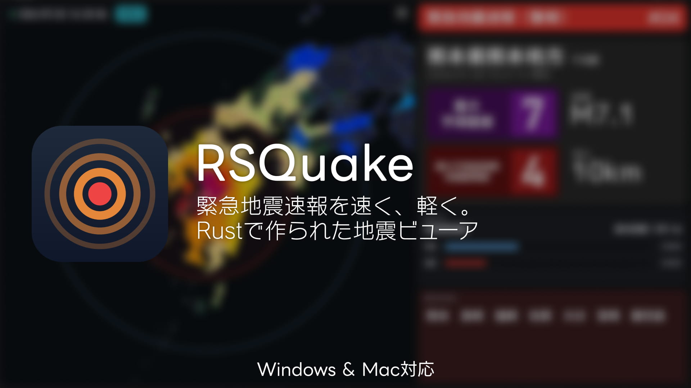

# RSQuake

緊急地震速報と強震モニタを表示する、Rust製のデスクトップアプリです。



## 機能

- 緊急地震速報(警報・予報)の受信と、震源・予報円・予想震度の地図表示
- 強震モニタのリアルタイム震度の表示
- 指定地点(緯度経度)までの距離と、P波・S波の到達状況の表示
- 予報・警報ごとの効果音(音ごとのオンオフ、音量設定)
- 閉じてもトレイに常駐し、EEW が出たらウィンドウを前に出す(ゲームモードで止められます)

## インストール

[Releases](https://github.com/neruha/rsquake/releases) から、使っている環境に合ったファイルをダウンロードします。

| 環境 | ファイル |
|---|---|
| Windows (x64) インストーラー | `RSQuake-<バージョン>-windows-x64-installer.msi` |
| Windows (x64) ポータブル | `RSQuake-<バージョン>-windows-x64.zip` |
| macOS (Apple Silicon) | `RSQuake-<バージョン>-macos-arm64.dmg` |
| macOS (Intel) | `RSQuake-<バージョン>-macos-x86_64.dmg` |
| Linux (x86_64) | `RSQuake-<バージョン>-linux-x86_64.tar.gz` |
| Linux (aarch64 / ARM64) | `RSQuake-<バージョン>-linux-aarch64.tar.gz` |

Windows (x64) インストーラーを実行する際に「VCRUNTIME140.dllが見つかりません」と表示された場合は、[**Microsoft Visual C++ 再頒布可能パッケージ**](https://learn.microsoft.com/ja-jp/cpp/windows/latest-supported-vc-redist?view=msvc-170#latest-supported-redistributable-version)をインストールしてください。

Linux には、Ubuntu 22.04 相当以降の glibc と、ALSA (`libasound2`)、Vulkan に対応したグラフィックスドライバが必要です。

展開して `install.sh` を実行すると、管理者権限なしで `~/.local` に入り、GNOME や KDE のアプリ一覧に「RSQuake」が出ます。

```bash
tar xzf RSQuake-<バージョン>-linux-x86_64.tar.gz
cd RSQuake-<バージョン>-linux-x86_64
./install.sh
```

- 実行ファイルは `~/.local/bin/rsquake`、アイコンは `~/.local/share/rsquake/`、ランチャーは `~/.local/share/applications/rsquake.desktop` に入ります。`PREFIX=/opt/rsquake ./install.sh` のように、`~/.local` 以外へ入れることもできます
- アプリ一覧に出ないときは、いちどログインし直してください
- 消すときは、同じフォルダの `./uninstall.sh` を実行します (設定ファイルは残ります)
- インストールせず、展開した `rsquake` をそのまま実行することもできます

Windows と macOS の配布物には正式な署名がありません。起動時に警告が出たときは、次のように起動してください。

- Windows: 警告の「詳細情報」から実行します。
- macOS:
  1. アプリを右クリックして「開く」を選びます。
  2. 「開けません」と表示されたら、一度閉じて「システム設定」→「プライバシーとセキュリティ」を開きます。
  3. 画面を下へスクロールし、「このまま開く」を押します。

## 使い方

起動すると、設定した受信元からWebSocket接続でEEWを受け取り、強震モニタの取得も始めます。

設定は画面の設定から変更できます。主な項目は次のとおりです。

| 項目 | 内容 |
|---|---|
| 指定地点 | 緯度と経度(度の小数。北緯と東経が正)を入力します。予想パネルに、この地点までの距離とP波・S波の到達状況を出します。空にすると出しません |
| 細分区域の表示 | 区域ごとに予想震度を出す「詳細」と、警報の地域だけを震度なしでまとめて出す「簡易」から選びます |
| 複数の EEW を切り替える間隔 | EEW が複数あるときに表示を切り替える間隔(秒)です。新しいイベント、初めての警報、取消が出たときは、間隔を待たずに切り替えます |
| 自動でズームする | 予報円が収まる範囲へ地図を寄せます。手で動かすと止まり、10秒後に再開します |
| 訓練報・試験報を表示 | オンにすると、情報パネルの帯に「訓練」「試験」と出ます |
| 鳴らす音 | 予報、警報それぞれのオンオフと、全体の音量を設定します。音量を0%にすると試聴も含めて鳴りません |
| 常駐 | 閉じたときに終了せず、タスクトレイ(macOS はメニューバー)に残します。EEW の受信と効果音は続きます。アイコンのクリックかメニューの「ウィンドウを表示」で開き直し、メニューの「終了」で終わります |
| EEW 発生時の表示 | EEW が出たら、隠れているウィンドウや最小化したウィンドウを前に出します。予報と警報のどちらで出すかを選べます。EEW が終わったら元の状態に戻します(ウィンドウを操作したときは戻しません) |
| ゲームモード | 有効の間は、常駐と EEW 発生時の表示を止めます。全画面のゲームなどの邪魔をしたくないときに使います。設定画面の「動作」かトレイのメニューで切り替えます。設定として保存され、次回の起動にも引き継がれます。有効の間にウィンドウを閉じると終了します |
| 更新 | 起動時に GitHub Releases で新しいバージョンを確認します。プレリリースを含めるかも選べます。新しい版があれば、ポップアップの「更新する」(または設定の「更新する」)で、アプリ内でダウンロードして更新できます。「自動で更新」をオンにすると、確認なしで更新します。EEW が出ている間は、ポップアップを出さず、再起動も終わるまで待ちます |

設定は次のファイルに保存されます。

| OS | 場所 |
|---|---|
| Windows | `%APPDATA%\rsquake\config.toml` |
| macOS | `~/Library/Application Support/rsquake/config.toml` |
| Linux | `~/.config/rsquake/config.toml` (`$XDG_CONFIG_HOME` があればその下) |

### アプリ内の更新

ダウンロードした配布物は、`SHA256SUMS` の minisign 署名と SHA-256 を確かめてから入れ替えます。どれか 1 つでも合わなければ、入れ替えずに元の版のまま動かします。

次の場合は、アプリ内では更新せず、GitHub の Release のページへ案内します。

- Windows で、古いインストーラーで `Program Files` に入れた版を使っているとき。いちどアンインストールして、新しいインストーラーで入れ直してください。入れ直したあとは、更新で管理者権限を求められません(インストール先は `%LOCALAPPDATA%\Programs\RSQuake` になります)
- macOS で、ディスクイメージの中から直接起動しているとき、または macOS が一時的な場所から起動しているとき。アプリを「アプリケーション」フォルダなどへ移してから起動してください
- アプリのあるフォルダに書き込めないとき

Linux ではアプリ内の更新に対応していません。新しい版は Release のページから入れ替えてください。また、トレイへの常駐と描画方式の選択も使えません (閉じると終了します)。

### 受信元

このバージョンで選べる EEW の受信元は [Wolfx](https://wolfx.jp/) のみです。DMDATA は開発中のため、選ぶことができません。

Wolfx には長周期地震動階級と「以上」の表記がなく、細分区域が DMDATA より少ないことがあります。

## ビルド

edition 2024 に対応した Rust の stable ツールチェーンが必要です。

```powershell
cargo run --release
```

配布用のパッケージは次のスクリプトで `dist/` に作ります。

```powershell
# Windows (.zip と .msi。.msi には WiX CLI 5.0.2 が必要です)
powershell -File scripts/package-windows.ps1
```

```bash
# macOS (arm64 と x86_64 を別々の .dmg にします)
bash scripts/package-macos.sh both
```

```bash
# Linux (動いているマシンの arch 向けに .tar.gz を作ります。x86_64 / aarch64 を指定することもできます)
# ビルドには build-essential pkg-config libasound2-dev (Debian / Ubuntu) が必要です
bash scripts/package-linux.sh
```

GitHub Actions のリリースでは、macOS と Linux を arch ごとのランナー (aarch64 / x86_64) でビルドし、別々のファイルにします。

### リリース (開発者向け)

アプリ内の更新は、リリースの `SHA256SUMS` を minisign の鍵で署名した `SHA256SUMS.minisig` を使います。

- 公開鍵は `src/update/verify.rs` の `PUBLIC_KEY` に埋め込んであります
- 秘密鍵は GitHub Actions の secret `MINISIGN_SECRET_KEY`(鍵ファイルの中身)に入れます。パスワード無しで作った鍵を使います
- 鍵を作り直すと、古い版のアプリが新しい版を受け付けなくなります。秘密鍵は失くさないよう、安全な場所に保管してください
- 鍵の作り方: `minisign -G -W -p rsquake.pub -s rsquake.key`

## ライセンス

このプロジェクトのライセンスは GNU General Public License v3 です。全文は [LICENSE](LICENSE) にあります。

## クレジット

- 観測点リスト: [kyoshin-monitor-observation-points](https://github.com/ingen084/kyoshin-monitor-observation-points)(MIT)
- リアルタイム震度の画像: 強震モニタ(防災科学技術研究所)
- 緊急地震速報の受信元: [Wolfx Project](https://wolfx.jp/)
- フォント: Gen Interface JP、LINE Seed JP、M PLUS 1p ほか(SIL Open Font License 1.1)
- 効果音: Freesound の「Notification」(IENBA、CC BY 4.0)と「Text Message」(LoudKevin、CC0 1.0)。どちらも加工して使用

ライセンスの全文はアプリの設定画面の「ライセンス」欄から読めます。
