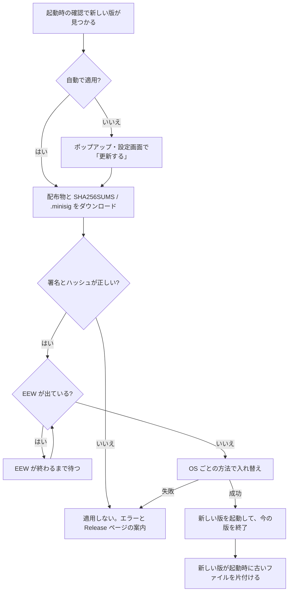

# 自動アップデート 実装計画

イシュー: [#9 自動アップデートを実装する](https://github.com/neruha/rsquake/issues/9)

今の更新機能は、起動時に GitHub Releases を見て新しい版をポップアップで知らせるだけである (`src/update/mod.rs`)。これを、アプリ内でダウンロード・検証・入れ替え・再起動までできるようにする。

署名の有無で取れる方式が変わるので、最初に検証 (Phase 0) を行い、その結果でこの計画を確定させる。検証の結果は 8 章に書き足す。

## 1. 方針 (検証前の仮決め)

| 項目 | 方針 |
|---|---|
| 実装方式 | 自前で実装する。`self_update` などは配布形式 (msi / dmg) と入れ替え手順が合わないため使わない |
| 配布形式 | 今のまま (Windows: msi と zip、macOS: dmg)。dmg はマウントして中の `.app` を取り出す |
| 改ざんの確認 | `SHA256SUMS` に加えて、`SHA256SUMS` 自体を minisign で署名する。公開鍵はアプリに埋め込む |
| Windows のインストール先 | MSI を `perUser` にし、`%LOCALAPPDATA%\Programs\RSQuake` に入れる。更新で UAC を出さない |
| macOS の入れ替え | 動いている `.app` と同じフォルダで、新しい `.app` と名前を入れ替える。`/Applications` は管理者権限なしで書き込める |
| 適用のきっかけ | 既定は「確認してから適用」。設定で「自動で適用」を選べる |
| EEW 中 | ダウンロードはしてよいが、適用と再起動はしない。EEW が終わるまで待つ |
| 失敗時 | 元の版のまま動かし、Release のページへの案内を出す |

OS のコード署名 (Apple の公証、Windows の Authenticode) は、Phase 0 の結果で導入するか決める。導入しなくても、minisign の署名で「配布元が出した物か」は確認できる。

## 2. 全体の流れ



## 3. 配布物の選び方

リリースの assets から、名前で 1 つ選ぶ。今の命名 (`scripts/package-*.{sh,ps1}`) をそのまま使う。

| 環境 | 判定 | ファイル |
|---|---|---|
| Windows インストーラー版 | 実行ファイルが `%LOCALAPPDATA%\Programs\RSQuake\` にある | `RSQuake-<版>-windows-x64-installer.msi` |
| Windows ポータブル版 | 上以外 | `RSQuake-<版>-windows-x64.zip` |
| macOS Apple Silicon | `cfg!(target_arch = "aarch64")` | `RSQuake-<版>-macos-arm64.dmg` |
| macOS Intel | `cfg!(target_arch = "x86_64")` | `RSQuake-<版>-macos-x86_64.dmg` |

次の場合はアプリ内で更新せず、今と同じく Release のページへ案内する。

- 対応する asset、`SHA256SUMS`、`SHA256SUMS.minisig` のどれかがリリースに無い
- Windows で `Program Files` に入った古いインストーラー版 (4.3 の移行を案内する)
- macOS で dmg の中から直接起動している、または App Translocation で一時的な場所から起動している
- 入れ替え先のフォルダに書き込めない

ダウンロード URL は `https://github.com/neruha/rsquake/releases/download/` で始まるものだけ受け付ける (リダイレクト先の `objects.githubusercontent.com` は許可する)。今の `is_release_url` と同じ考え方にする。

## 4. OS ごとの入れ替え

入れ替えは、アプリ自身を別の引数で起動した「適用役」に任せる。本体は適用役を起動したらすぐ終了し、適用役は本体のプロセスが終わるのを待ってから作業する。別の実行ファイルは同梱しない。

```
RSQuake --apply-update <作業フォルダ> --wait-pid <本体の PID>
```

作業フォルダには、検証済みの配布物と、何をするかを書いた小さな JSON を置く。適用役はログを作業フォルダに残し、次に起動した本体が結果を読んで、失敗していれば知らせる。

### 4.1 Windows インストーラー版

1. 適用役が本体の終了を待つ
2. `msiexec /i <msi> /passive /norestart` を実行する。`perUser` なので UAC は出ない
3. 終了コードが 0 (または 3010) なら新しい `RSQuake.exe` を起動する。それ以外なら古い版を起動し直し、失敗を記録する

適用役は、インストールで上書きされないよう、作業フォルダにコピーした exe から起動する。

### 4.2 Windows ポータブル版

1. zip から `RSQuake.exe` を作業フォルダに取り出す
2. 動いている `RSQuake.exe` を `RSQuake.exe.old` に名前を変える (実行中でも名前の変更はできる)
3. 新しい exe を元の場所に置く。失敗したら `.old` を元の名前に戻す
4. 新しい exe を起動する。新しい版は起動時に `.old` を消す

ポータブル版は本体だけで完結するので、適用役を使わずに本体の中で行ってもよい。実装時に 4.1 とそろえるか決める。

### 4.3 Windows のインストール先の移行 (`perMachine` → `perUser`)

`wix/main.wxs` の変更:

- `Scope="perUser"` にする
- `StandardDirectory Id="ProgramFiles64Folder"` を `LocalAppDataFolder` 配下の `Programs\RSQuake` にする
- ユーザー単位のインストールでは、各 Component の KeyPath を HKCU のレジストリ値にする必要がある (ICE38 / ICE64 対策)

問題は、`perMachine` と `perUser` の間では `MajorUpgrade` が効かず、古い版を自動で消せないことである。案は次の 2 つ。

| 案 | 内容 | 欠点 |
|---|---|---|
| A. 手動で消してもらう | 新しい MSI の初回だけ README とポップアップで「古い版をアンインストールしてから入れる」と案内する | 二重インストールが起きうる |
| B. 古い版を検出する | 新しい MSI で古い版の ProductCode を検出し、残っていれば止めて案内を出す | 自動では消せない (消すには管理者権限が要る) |

B を基本にし、検出して案内するところまでにする。移行は 1 回だけで、移行後の版からは UAC なしで更新できる。

### 4.4 macOS

1. `hdiutil attach -nobrowse -readonly -mountpoint <作業フォルダ>/mnt <dmg>` でマウントする
2. `ditto` で `RSQuake.app` を、動いている `.app` と同じフォルダの `.RSQuake.app.new` に複製する (同じボリュームに置き、名前の変更で入れ替えられるようにする)
3. マウントを外す
4. `codesign --verify --deep --strict` で、複製した `.app` の署名が壊れていないか確認する (今はアドホック署名)
5. `com.apple.quarantine` 属性が付いていれば外す
6. 本体の終了を待ってから、`RSQuake.app` → `.RSQuake.app.old`、`.RSQuake.app.new` → `RSQuake.app` と名前を変える。失敗したら戻す
7. `open -n RSQuake.app` で起動する。新しい版は起動時に `.old` を消す

## 5. 改ざんの確認

1. `SHA256SUMS` と `SHA256SUMS.minisig` をダウンロードする
2. アプリに埋め込んだ minisign の公開鍵で、`SHA256SUMS` の署名を確かめる (`minisign-verify` クレート)
3. 配布物の SHA-256 を計算し、`SHA256SUMS` の該当行と比べる
4. どれか 1 つでも合わなければ、ファイルを消して適用しない

秘密鍵は GitHub Actions の secret に入れ、`release.yml` の Checksums の手順で署名する。鍵を作り直すと古い版のアプリが更新を受け付けなくなるので、鍵の保管場所と手順を README の開発者向けの部分に残す。

## 6. 設定と画面

### 6.1 設定 (`config.toml` の `[update]`)

| 項目 | 型 | 既定 | 内容 |
|---|---|---|---|
| `auto_apply` | bool | false | 新しい版を見つけたら、確認せずに適用する |

既存の `check`、`include_prerelease`、`skipped_version` はそのまま使う。スキップした版は自動でも適用しない。`check` がオフなら自動適用もしない。

### 6.2 状態

`update::Phase` に、ダウンロードと適用の状態を足す。

| 状態 | 画面 |
|---|---|
| `Downloading { done, total }` | 進行状況のバー |
| `Verifying` | 確認中 |
| `Ready` | 「再起動して更新」ボタン (自動のときは EEW が無ければすぐ適用) |
| `WaitingForEew` | 「緊急地震速報が終わったら更新します」 |
| `Applying` | 適用役を起動して終了するまで |
| `UpdateFailed(String)` | 失敗の理由と Release ページへのリンク |

### 6.3 画面

- ポップアップ (`src/ui/update_popup.rs`): 「更新する」ボタンを足す。押すとダウンロードを始め、ポップアップは閉じて設定画面の状態に引き継ぐ
- 設定画面の更新のページ (`src/ui/settings.rs` の `update_page`): 「自動で適用する」のチェックと、6.2 の状態、「更新する」「再起動して更新」ボタンを足す
- 前回の更新が失敗していたら、起動時のポップアップで知らせる

## 7. 進め方

### Phase 0: 検証 (コードは試作だけ)

イシューの「検証が必要なこと」を、試作のプログラムと実機で確かめる。

- macOS: アドホック署名の `.app` を 4.4 の手順で入れ替えて、`open` で起動したとき Gatekeeper の警告が出ないか。reqwest でダウンロードした dmg に quarantine 属性が付くか。Apple Silicon と Intel の両方
- Windows: 署名のない msi を `msiexec /passive` で入れたとき、また exe を差し替えて起動したときに、SmartScreen やウイルス対策ソフト (Defender) が止めないか
- Windows: `perUser` の MSI が UAC なしで入り、同じ `perUser` の新しい MSI で `MajorUpgrade` が効くか。`perMachine` の古い版を検出できるか
- 費用: Apple Developer Program、Azure Trusted Signing などのコード署名を入れる場合の費用と CI への組み込み方

結果を 8 章に書き、OS ごとに「アプリ内で更新する / 通知だけにする」を決める。

### Phase 1: 配布の準備

- `wix/main.wxs` を `perUser` にし、古い版の検出と案内を入れる (4.3)
- minisign の鍵を作り、`release.yml` で `SHA256SUMS.minisig` を出す (5 章)
- この版を先に出しておく。移行後の版からは、次の版をアプリ内で更新できる

### Phase 2: ダウンロードと確認

- `src/update/` に、asset の選択 (3 章)、ダウンロード (進行状況つき)、署名とハッシュの確認 (5 章) を足す
- 確認を終えたファイルを作業フォルダ (設定フォルダの下の `update/`) に置くところまで
- 単体テスト: asset の選択、`SHA256SUMS` の読み取り、署名の検証 (正しい・壊れた・鍵が違う)、URL の制限

### Phase 3: 入れ替えと再起動

- `--apply-update` の適用役と、OS ごとの入れ替え (4 章)
- 起動時の片付け (`.old` の削除、前回の結果の読み取り)
- EEW 中は適用しない (`WaitingForEew`)

### Phase 4: 設定と画面

- `auto_apply` の設定、ポップアップと設定画面 (6 章)
- デバッグメニュー (`src/dev/debug_menu.rs`) に、ダウンロード中・失敗などの状態を出す項目を足す

### Phase 5: 仕上げ

- README の「インストール」「更新の確認」を更新する (インストール先の移行の案内を含む)
- 試験用のリリース (プレリリース) を 2 つ出し、Windows (インストーラー版・ポータブル版) と macOS (Apple Silicon・Intel) の実機で、更新して新しい版で起動することを確かめる
- 失敗の確認: 壊したファイル、署名のない `SHA256SUMS`、書き込めないフォルダ、EEW 中の適用

開発中は、既存の `RSQUAKE_UPDATE_URL` と `RSQUAKE_UPDATE_CURRENT` (デバッグビルドだけ) で、手元のモックサーバーと古い版のふりを使って試す。

## 8. 検証の結果

(Phase 0 の結果をここに書く)

## 9. 未決のこと

- OS のコード署名を導入するか (Phase 0 の費用と警告の結果で決める)
- ポータブル版の入れ替えを適用役にそろえるか (4.2)
- 移行前の `Program Files` 版の利用者に、新しい版をどう案内するか (4.3 の案 B の文言)
